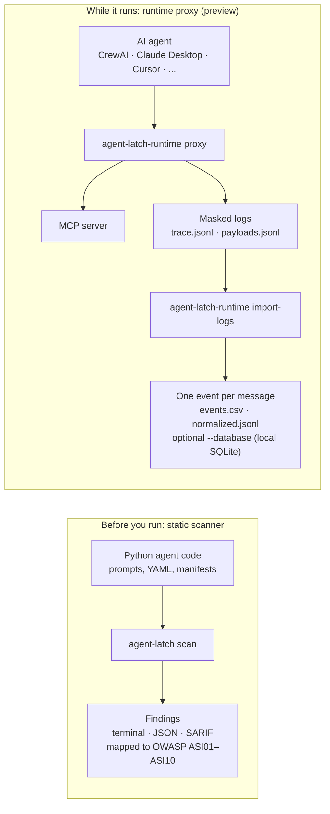
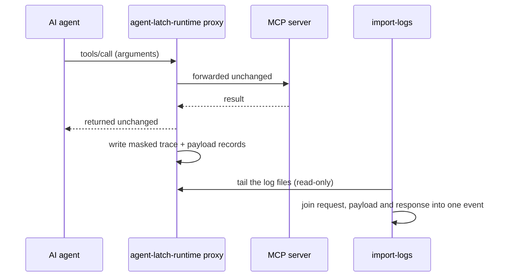

<p align="center">
  <picture>
    <source media="(prefers-color-scheme: dark)" srcset="https://raw.githubusercontent.com/AgentLatch/agent-latch/main/docs/assets/brand/agentlatch-logo-dark.png">
    
  </picture>
</p>

# AgentLatch — Local-First AI Agent Security Scanner and MCP Traffic Monitor

[](https://github.com/AgentLatch/agent-latch/actions/workflows/tests.yml)
[](https://github.com/marketplace/actions/agentlatch-scan)
[](https://github.com/AgentLatch/agent-latch/blob/main/LICENSE)
[](https://youtu.be/4FrRWlApDpo)

**Find selected security risks in AI-agent projects before you run them, and see what your agent does with its MCP tools while it runs.** AgentLatch is an open-source, local-first AI agent security toolkit with two parts:

- **Static scanner** (`agent-latch scan`): checks Python agent code, agent manifests (tools, permissions, authentication) and prompt templates, optionally audits pinned Python dependencies, and reports evidence in your terminal, JSON or SARIF. Run it from the command line, as a pre-commit hook or as a GitHub Action.
- **Runtime proxy for MCP, preview** (`agent-latch-runtime`): sits between an AI agent and a Model Context Protocol (MCP) server and records every tool list, tool call, result and prompt, with secrets masked. Monitor only: it never blocks or changes traffic.


> **Project status: early proof of concept.** AgentLatch is not a complete vulnerability scanner, runtime protection system, security score, or certification. A clean scan means only that the enabled checks did not report a finding. The runtime proxy records traffic and runs one preview gate, ALR04, on MCP tool definitions. It reports findings and does not block calls.

## Contents

- [Quick start: scan an agent project](#quick-start-scan-an-agent-project)
- [How it works](#how-it-works)
- [Runtime monitoring for MCP (preview)](#runtime-monitoring-for-mcp-preview)
- [What the scanner checks today](#what-the-scanner-checks-today)
- [OWASP Agentic Top 10 coverage](#owasp-agentic-top-10-coverage)
- [Documentation](#documentation)
- [Why AgentLatch?](#why-agentlatch)
- [Reports and data handling](#reports-and-data-handling)
- [Important limitations](#important-limitations)
- [FAQ](#faq)
- [Development and tests](#development-and-tests)
- [Roadmap](#roadmap)
- [Contributing and security reports](#contributing-and-security-reports)

## Quick start: scan an agent project

Requires Python 3.11+. Install AgentLatch from PyPI with [pipx](https://pipx.pypa.io), which keeps it in its own environment (Windows and other options: see [Getting started](https://github.com/AgentLatch/agent-latch/blob/main/docs/getting-started.md#install)):

```sh
pipx install agentlatch-security
```

Or install it into a virtual environment with pip:

```sh
python3 -m venv .venv && source .venv/bin/activate
python -m pip install agentlatch-security
```

On PyPI, AgentLatch is published as `agentlatch-security`. It installs the `agent-latch` and `agent-latch-runtime` commands. The PyPI package named `agentlatch` is a separate project.

Scan an agent project:

```sh
agent-latch scan /path/to/my-agent
```

No configuration or agent manifest is needed: every folder and text file is scanned. Suppressions inside the scanned project (`.agent-latch-ignore`, inline ignore comments) are not applied unless you add `--project-ignores`, so a project you scan cannot hide its own findings.

Try it on the deliberately insecure example in this repository:

```sh
git clone https://github.com/AgentLatch/agent-latch.git
agent-latch scan agent-latch/examples/vulnerable-agent
```

Watch the demo: scanning the example and failing CI with `--fail-on high`.

[](https://youtu.be/4FrRWlApDpo)

More ways to run it:

```sh
agent-latch scan --config agent-manifest.yaml        # also audit a manifest's declared tools (optional)
agent-latch scan . --project-ignores                 # your own repo: apply its .agent-latch-ignore
agent-latch scan . --min-severity medium             # hide low and info findings (still counted)
agent-latch scan . --dependencies                    # add known-vulnerability checks (sends package names to PyPI)
agent-latch scan . --fail-on high                    # exit 1 on high-severity findings, for CI
agent-latch scan . --exclude tests/                  # skip a path for one run
agent-latch scan . --format sarif --output results.sarif
agent-latch --interactive                            # guided mode
```

Block risky changes automatically with the [pre-commit hook](https://github.com/AgentLatch/agent-latch/blob/main/docs/ci.md#pre-commit-hook) or the GitHub Action ([setup guide](https://github.com/AgentLatch/agent-latch/blob/main/docs/ci.md#github-actions), [Marketplace listing](https://github.com/marketplace/actions/agentlatch-scan)):

```yaml
- uses: AgentLatch/agent-latch@v0.4.0
  with:
    fail-on: high
    # min-severity: medium      # optional: hide low and info findings
    # project-ignores: "true"   # apply your repo's .agent-latch-ignore (see the note below)
```

> **Upgrading from v0.1.0:** the project's own `.agent-latch-ignore`, `pyproject.toml` excludes, and inline ignore comments are no longer applied by default. If your repository relies on them, add `project-ignores: "true"` to the Action or `--project-ignores` on the command line. See the [v0.2.0 release notes](https://github.com/AgentLatch/agent-latch/blob/main/docs/release-notes/v0.2.0.md).

## How it works

AgentLatch looks at an agent at two different times. The scanner reads the project's files before anything runs. The runtime proxy watches the agent's MCP tool traffic while it runs. Both stay on your machine.



The scanner never imports or runs the code it checks. The proxy passes every MCP message through unchanged and never blocks anything.

## Runtime monitoring for MCP (preview)

`agent-latch-runtime` records what an AI agent asks its MCP tools to do and what comes back, so you can review an agent's tool use after a run. It is a **preview and monitor only**. It records every message and runs ALR04, which reports a finding when a tool definition contains instruction-like content. It does not block calls. After a run, `agent-latch --runtime-result` prints those findings in the same table as a scan, including a local tool's file and line when the project defines that tool. The report lists findings only.

### Try it in one command

Install with the `runtime` extra, which adds FastMCP:

```sh
pipx install "agentlatch-security[runtime]"      # or: python -m pip install "agentlatch-security[runtime]"
agent-latch-runtime demo
```

`demo` starts a bundled synthetic MCP server behind the real proxy, lists its tools, calls three of them (one returns a fake credential, one fails), gets a prompt, then imports the logs. This is real output:


The files land in `runtime-logs/demo/` (git-ignored). The fake credential appears only as `[REDACTED]` in every one of them.

### Watch a real agent

Put the proxy in front of any MCP server, then follow its logs from a second terminal:

```sh
# Terminal 1: the agent's MCP traffic goes through the proxy.
agent-latch-runtime proxy --trace runtime-logs/trace.jsonl --payloads runtime-logs/payloads.jsonl \
  -- npx -y @modelcontextprotocol/server-github

# Terminal 2: one line per message, plus events.csv and normalized.jsonl in runtime-logs/.
agent-latch-runtime import-logs
```

Run both from the same folder, in the environment where AgentLatch is installed. `mcp-server/.venv` does not provide `agent-latch-runtime`.

To also keep a queryable copy, name a local SQLite file. That flag is the choice of store. Leave it off and nothing is written except the CSV and JSONL files. Nothing is uploaded.

```sh
agent-latch-runtime import-logs --database runtime-logs/runtime.db
```

SQLite is the first store. The importer calls it through a small `EventStore` interface, so a later destination can be selected the same way without becoming part of the default install. Details: [Store events in SQLite](https://github.com/AgentLatch/agent-latch/blob/main/docs/runtime.md#store-events-in-sqlite).



Step-by-step guides with expected output at each step:

- [Connect an app](https://github.com/AgentLatch/agent-latch/blob/main/docs/runtime.md#connect-an-app) (Claude Code, Claude Desktop, Cursor, or any MCP config)
- [Live run with a CrewAI agent, plus 20 test scenarios](https://github.com/AgentLatch/agent-latch/blob/main/mcp-server/SETUP.md#part-4-watch-a-live-agent-run-with-agentlatch) (normal calls, errors, fake secrets, SSRF attempts, injection-shaped input)
- [Claude Desktop on Windows with the MCP server in WSL](https://github.com/AgentLatch/agent-latch/blob/main/mcp-server/SETUP.md#4b-claude-desktop-on-windows-with-the-gateway-in-wsl)

### What the proxy records

| MCP message | Trace (always) | Full payload (`--payloads`) |
|---|---|---|
| `tools/list`: tool names, descriptions, schemas | ✅ | ✅ |
| `tools/call`: request, response and error | ✅ | ✅ (a failed call is logged with its error type) |
| `prompts/get`: request and response | ✅ | ✅ |
| `prompts/list` | ✅ | names only |

The **trace** keeps argument names, sizes, SHA-256 hashes and a short secret-masked excerpt, never raw values. The opt-in **payloads** file keeps full argument values and tool output, secret-masked and cut to `--payload-max-chars`. `import-logs` joins the two into one event per message.

**Not recorded yet:** `resources/list` and `resources/read`, `initialize`, `sampling/createMessage`, notifications (including `tools/list_changed`), image, audio and embedded-resource content in tool results, and a failed `prompts/get`. These pass through the proxy unchanged with no record. The proxy also never sees the user's chat with the model, an app's built-in tools, or servers not routed through it. Details: [docs/runtime.md](https://github.com/AgentLatch/agent-latch/blob/main/docs/runtime.md#limits).

## What the scanner checks today

| Rule | Detection | OWASP Agentic mapping |
|---|---|---|
| `AGENTLATCH-PY001` | Direct Python `eval()` and `exec()` calls | ASI05 Unexpected Code Execution (RCE); ASI02 Tool Misuse and Exploitation |
| `AGENTLATCH-PY002` | `subprocess.*(..., shell=True)` calls | ASI05 Unexpected Code Execution (RCE); ASI02 Tool Misuse and Exploitation |
| `AGENTLATCH-PY003` | Calls with a literal `verify=False` argument | ASI02 Tool Misuse and Exploitation |
| `AGENTLATCH-AG001` | CrewAI `Agent(..., allow_delegation=True)` review hint | ASI02 Tool Misuse and Exploitation; ASI03 Identity and Privilege Abuse |
| `AGENTLATCH-AG002` | LangChain `create_pandas_dataframe_agent(...)` code-execution capability | ASI05 Unexpected Code Execution (RCE); ASI02 Tool Misuse and Exploitation |
| `AGENTLATCH-AG003` | Web-search, web-loader, or HTTP output flowing unfenced into an LLM message (indirect prompt injection) | ASI01 Agent Goal Hijack |
| `AGENTLATCH-AG004` | Function exposed to the model as a tool that runs commands, writes files, sends email, or writes data, with no human-approval gate | ASI02 Tool Misuse and Exploitation; ASI05 / ASI03; ASI09 |
| `AGENTLATCH-AG005` | Agent given an unrestricted built-in tool (shell, Python REPL, unscoped file access) | ASI02 Tool Misuse and Exploitation; ASI05 / ASI03 |
| `AGENTLATCH-AG006` | Human approval turned off for agent actions (`human_input_mode="NEVER"` with code execution, `auto_approve=True`, `permission_mode="bypassPermissions"`) | ASI09 Human-Agent Trust Exploitation; ASI05 / ASI02 |
| `AGENTLATCH-AG007` | Agent loop with no effective limit (`max_iterations=None`, very high limits, `while True` around an agent call) | ASI08 Cascading Failures |
| `AGENTLATCH-SEC001` | Credential-like quoted assignments; matched value is redacted | ASI03 Identity and Privilege Abuse; ASI04 Agentic Supply Chain Vulnerabilities |
| `AGENTLATCH-DEP001` | Known advisory for a package in an audited requirements file | ASI04 Agentic Supply Chain Vulnerabilities |
| `AGENTLATCH-MAN001` | Manifest tool with a high-risk capability and no human-approval gate | ASI02 Tool Misuse and Exploitation; ASI05 / ASI03; ASI09 |
| `AGENTLATCH-MAN002` | Manifest tool with wildcard permissions | ASI02 Tool Misuse and Exploitation; ASI03 Identity and Privilege Abuse |
| `AGENTLATCH-MAN003` | Manifest tool calling a remote endpoint without authentication | ASI03 Identity and Privilege Abuse; ASI02 Tool Misuse and Exploitation |
| `AGENTLATCH-PRM001` | Prompt-injection signatures in prompts in code, YAML, prompt template files, and manifests | ASI01 Agent Goal Hijack |
| `AGENTLATCH-PRM002` | User-input placeholder interpolated into a system prompt | ASI01 Agent Goal Hijack |

Rule behavior and known blind spots are documented in [docs/RULES.md](https://github.com/AgentLatch/agent-latch/blob/main/docs/RULES.md).

## OWASP Agentic Top 10 coverage

How the scanner's rules map to the [OWASP Top 10 for Agentic Applications 2026](https://genai.owasp.org/resource/owasp-top-10-for-agentic-applications-for-2026/). This table is the static scanner. The runtime gate ALR04 also cites ASI01, ASI02, and ASI04 on a finding. That does not add a scanner check.

| ID | Category | Coverage | Rules |
|---|---|---|---|
| ASI01 | Agent Goal Hijack | ✅ checks | `AG003`, `PRM001`, `PRM002` |
| ASI02 | Tool Misuse and Exploitation | ✅ checks | `PY001`–`PY003`, `AG001`, `AG002`, `AG004`–`AG006`, `MAN001`–`MAN003` |
| ASI03 | Identity and Privilege Abuse | ✅ checks | `AG001`, `AG004`, `AG005`, `SEC001`, `MAN001`–`MAN003` |
| ASI04 | Agentic Supply Chain Vulnerabilities | ✅ checks | `SEC001`, `DEP001` |
| ASI05 | Unexpected Code Execution (RCE) | ✅ checks | `PY001`, `PY002`, `AG002`, `AG004`–`AG006`, `MAN001` |
| ASI06 | Memory & Context Poisoning | ⬜ no checks yet | |
| ASI07 | Insecure Inter-Agent Communication | ⬜ no checks yet | |
| ASI08 | Cascading Failures | 🟨 partial | `AG007` |
| ASI09 | Human-Agent Trust Exploitation | 🟨 partial | `AG004`, `AG006`, `MAN001` |
| ASI10 | Rogue Agents | ⬜ no checks yet | |

Every scan report ends with the same ASI01–ASI10 summary and marks the uncovered categories as `no checks yet`, so they aren't mistaken for clean results. A ✅ means some checks exist, not that the category is fully covered. The mapping is informational, not an OWASP endorsement or certification.

## Documentation

| Guide | Covers |
|---|---|
| [Getting started](https://github.com/AgentLatch/agent-latch/blob/main/docs/getting-started.md) | Install on Linux, macOS, WSL, and Windows; scanning; options; [ignoring false positives with `.agent-latch-ignore`](https://github.com/AgentLatch/agent-latch/blob/main/docs/getting-started.md#ignoring-false-positives-and-known-findings); output formats; exit codes; dependency audit; troubleshooting |
| [Agent manifests](https://github.com/AgentLatch/agent-latch/blob/main/docs/agent-manifest.md) | Declaring agents, tools, permissions, and prompts in `agent-manifest.yaml`, and what is checked |
| [pre-commit and CI](https://github.com/AgentLatch/agent-latch/blob/main/docs/ci.md) | pre-commit hook, GitHub Action inputs and outputs, other CI systems, choosing a threshold |
| [Detection rules](https://github.com/AgentLatch/agent-latch/blob/main/docs/RULES.md) | What every rule detects, its OWASP mapping, and its known blind spots |
| [Vulnerable example](https://github.com/AgentLatch/agent-latch/tree/main/examples/vulnerable-agent) | A demo project and the findings it should produce |
| [Runtime proxy for MCP (preview)](https://github.com/AgentLatch/agent-latch/blob/main/docs/runtime.md) | Install, connecting an app, what is recorded, `import-logs` and `demo`, limits. Optional local SQLite: [Store events in SQLite](https://github.com/AgentLatch/agent-latch/blob/main/docs/runtime.md#store-events-in-sqlite) |
| [MCP gateway](https://github.com/AgentLatch/agent-latch/blob/main/mcp-server/README.md) | A local MCP gateway for running agents against real tools, with [step-by-step setup](https://github.com/AgentLatch/agent-latch/blob/main/mcp-server/SETUP.md) for Claude Code, Claude Desktop, Cursor, Codex CLI, and HTTP clients, and [live runs through the runtime proxy](https://github.com/AgentLatch/agent-latch/blob/main/mcp-server/SETUP.md#part-4-watch-a-live-agent-run-with-agentlatch) |

## Why AgentLatch?

AI agents combine model-generated decisions with tools, credentials, code execution, and external data. Traditional code and dependency checks are useful, but they do not by themselves explain agent-specific risks. AgentLatch is a small starting point: run selected checks locally, inspect the exact file and evidence, see what an agent actually did with its tools, and map relevant findings to OWASP Agentic Top 10 categories.

The goal is to grow in layers:

1. **Now: local scanner.** Focused checks of Python source, agent manifests, and prompt templates; optional Python dependency advisories; portable reports; and pre-commit and GitHub Action integrations.
2. **Now, preview: runtime recording for MCP.** A proxy records live MCP tool traffic with secrets masked, and an importer turns it into reviewable events. `--database FILE` optionally keeps those events in a local SQLite file. It never blocks, and it does not upload them.
3. **Now, preview: one runtime gate.** ALR04 reports a finding when a MCP tool definition (name, description, or schema) contains instruction-like content, and maps that finding to ASI01, ASI02, and ASI04. Calls are not blocked. The report lists findings only.
4. **Planned: enforcement and adapters.** Blocking only when the operator turns it on in their own policy; framework adapters and broader evaluation checks after that.

These layers will remain clearly distinguished: detecting a risky pattern is not the same as testing agent behavior, and neither alone guarantees runtime enforcement.

## Reports and data handling

- Scans run locally. They do not call an LLM or upload your source code.
- The one exception is the opt-in dependency audit (`--dependencies`), which sends package names and versions to an advisory service. See [Dependency audit](https://github.com/AgentLatch/agent-latch/blob/main/docs/getting-started.md#dependency-audit).
- Detected secret values are redacted from evidence, but reports still include paths, line numbers, and code context. Review them before sharing.
- Every folder and every text file under the target is scanned, and no manifest is required. Only `.git`, installed environments (a folder with `pyvenv.cfg`, or an installed `node_modules`), symlinks, binary files, and files over 1 MB are skipped.
- The runtime proxy and importer write only to local files and send nothing anywhere. Their logs can hold tool arguments and output: secrets are masked by pattern, which can miss unusual formats, so keep `runtime-logs/` local and private (files are created with mode `0600`). `--database` adds another local file, SQLite, with the same rule: it can hold payloads, it is created with mode `0600` on macOS and Linux, and it is written only when you pass the flag.

## Important limitations

- Rules are static heuristics: aliases, wrappers, dynamic imports, generated code, non-Python languages, and runtime behavior can be missed.
- Findings can be false positives. A code-pattern match is not proof that an attacker can exploit it.
- No findings does not mean the agent is secure. Prompt checks cover prompts found in Python code, YAML, prompt template files, and agent manifests, plus web/tool content flowing into LLM messages in Python code. The scanner does not inspect model behavior, deployment configuration, or complete transitive dependency state.
- Manifest checks read what the manifest declares; they do not verify that your code enforces it. Source checks always run, and a manifest can only add findings.
- By default, nothing in the scanned project can hide a finding: its `.agent-latch-ignore`, `pyproject.toml` excludes, and inline ignore comments are not applied. Add `--project-ignores` for your own repositories.
- OWASP category IDs help organize selected findings; the mapping is not a compliance assessment, OWASP affiliation, or certification.
- The runtime proxy is a preview. It records only MCP traffic routed through it, does not record every MCP message type yet ([see above](#what-the-proxy-records)), and never blocks or changes a call. ALR04 reports findings on tool definitions only.

## FAQ

### How do I scan an AI agent project for security vulnerabilities?

Install AgentLatch and run `agent-latch scan /path/to/agent`. It checks Python agent code, an `agent-manifest.yaml` describing the agent's tools and prompts, and the prompt templates it references, then reports each finding with file, line, evidence, and an OWASP Agentic Top 10 mapping. Add `--dependencies` to check pinned Python packages for known advisories.

### How do I monitor the MCP tool calls my AI agent makes?

Put `agent-latch-runtime proxy` in front of the MCP server, either in your app's MCP config or as an HTTP proxy, and run `agent-latch-runtime import-logs` next to it from the same folder. Every tool list, tool call, result and prompt is recorded with secrets masked, and shown as one event per message. Add `--database runtime-logs/runtime.db` when you want those events in a local SQLite file as well. Run `agent-latch-runtime demo` to see the whole flow first. See [Runtime monitoring for MCP](#runtime-monitoring-for-mcp-preview).

### Can AgentLatch block a dangerous MCP tool call?

No. The runtime proxy is monitor only: it passes every message through unchanged. ALR04 records a finding when a tool definition looks hostile. Blocking is planned only as an opt-in the operator turns on in their own policy.

### Can AgentLatch detect prompt injection?

It detects three static signals: instruction-override phrases such as "ignore all previous instructions" in prompt templates (`PRM001`), user input interpolated into system prompts (`PRM002`), and **indirect prompt injection** paths where web-search, web-page, or HTTP content flows into an LLM message without delimiters (`AG003`). It does not test model behavior at runtime, so it cannot prove an agent resists prompt injection.

### Which AI agent frameworks does it support?

The source rules work on any Python code. Framework-specific checks cover CrewAI delegation, LangChain's dataframe agent and web/search tools (Tavily, DuckDuckGo, WebBaseLoader, and others), and data flowing through LangGraph state. Manifest and prompt checks are framework-agnostic. JavaScript and TypeScript agents are not scanned yet. The runtime proxy works with any agent or app that talks to MCP servers, whatever language it is written in.

### How do I check AI agent security in CI or GitHub Actions?

Use the [GitHub Action](https://github.com/marketplace/actions/agentlatch-scan) (`uses: AgentLatch/agent-latch@v0.4.0`) to scan every push and pull request and show findings in GitHub code scanning, or the [pre-commit hook](https://github.com/AgentLatch/agent-latch/blob/main/docs/ci.md#pre-commit-hook) to block risky commits. Any other CI can run `agent-latch scan --fail-on high`, which exits with code 1 when high-severity findings exist.

### Does AgentLatch upload my code or call an LLM?

No. Scanning runs locally and does not call any model, and the runtime proxy writes only local files. The only network use is the opt-in dependency audit, which sends package names and versions to an advisory service, and the GitHub Action's optional upload of the findings report to GitHub code scanning.

### How does it map to the OWASP Top 10 for Agentic Applications?

Each finding lists the related categories, for example ASI01 Agent Goal Hijack for prompt injection, ASI02 Tool Misuse for over-privileged tools, and ASI05 Unexpected Code Execution for `eval` or `shell=True`. See the [coverage table](#owasp-agentic-top-10-coverage). The mapping is informational, not a compliance assessment or OWASP endorsement.

### How do I handle false positives?

List accepted findings in a [`.agent-latch-ignore`](https://github.com/AgentLatch/agent-latch/blob/main/docs/getting-started.md#ignoring-false-positives-and-known-findings) file, by path, rule, or exact line, or add an inline `# agent-latch: ignore[RULE]` comment, and scan with `--project-ignores`. These are off by default so a project you scan cannot hide its own findings. Every report states how many findings were suppressed.

### Does a clean scan mean my agent is secure?

No. AgentLatch runs a focused set of static checks. A clean scan means only that those checks found nothing; it is not a security certification.

## Development and tests

```sh
git clone https://github.com/AgentLatch/agent-latch.git && cd agent-latch
python3 -m venv .venv && source .venv/bin/activate
python -m pip install -e ".[dev,audit,runtime]"
python -m pytest
ruff check .
```

Tests use synthetic fixtures and mock the dependency-audit subprocess, so they make no network calls. Runtime tests that need FastMCP are skipped without the `runtime` extra. See [CONTRIBUTING.md](https://github.com/AgentLatch/agent-latch/blob/main/CONTRIBUTING.md) for writing new rules.

## Roadmap

The longer-term direction is a layered AI-agent security toolkit. Each layer should have its own stated coverage and tests:

- **Scanner (current):** expand well-scoped rules, language support, dependency manifest support, and SARIF quality.
- **Runtime checks (preview):** recording and importing MCP tool traffic works today. Next come the missing MCP message types (resources, `initialize`, non-text content), then detection gates on the recorded events, mapped to OWASP categories. Monitor mode (findings only) stays the default; allow, deny, ask, or fence decisions apply only when the operator enables enforcement in their own policy. Checks cover only traffic routed through AgentLatch. Framework adapters and an HTTP sidecar come after that.
- **Evaluation (planned):** reproducible test cases for selected agent security behaviors, with transparent methodology and no single opaque "safe" score.
- **Hosted scanning service (future, not implemented):** require explicit consent, minimal repository access, retention/deletion policy, tenant isolation, and security review before accepting private source code.

The project will not claim to be an industry standard or a universal security guarantee. Interoperability, independent review, transparent tests, and community adoption must come before such claims.

## Contributing and security reports

See [CONTRIBUTING.md](https://github.com/AgentLatch/agent-latch/blob/main/CONTRIBUTING.md) for development and rule authoring, and [SECURITY.md](https://github.com/AgentLatch/agent-latch/blob/main/SECURITY.md) for responsible vulnerability reporting. Please submit synthetic test fixtures rather than real secrets or confidential source code.

## Name and standards references

AgentLatch is an independent open-source project. It references selected categories from the [OWASP Top 10 for Agentic Applications 2026](https://genai.owasp.org/resource/owasp-top-10-for-agentic-applications-for-2026/) where useful. OWASP is not affiliated with or endorsing AgentLatch.
