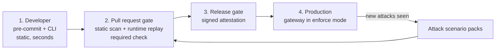

# AgentLatch vision

A single page to come back to when it's unclear what to build next or why.

## 1. Vision

> **AgentLatch helps companies ship AI agents safely by checking them before release and guarding them while they run.**

Everything we build fits under that sentence:

| What we have | Where it fits |
|---|---|
| Static scanner (CLI, pre-commit, GitHub Action) | **Check before release** |
| Runtime interceptor ([epic AL-RUNTIME-01](runtime/epic-al-runtime-01.md)) | **Guard while running** |
| `challenges/` and the injection lab | **Proof that it works** |
| OWASP Agentic Top 10 mapping and SARIF | **Reports security teams already understand** |
| Verified certificate idea | **Later:** proof for customers, built on top of the above |

## 2. How it fits together

The same engine, policy file, rule IDs and report format are used at every step. Only the packaging changes:

| Where | Packaging |
|---|---|
| Developer machine | PyPI (`pip install agent-latch[runtime]`), pre-commit |
| Pull requests / CI | GitHub Marketplace Action (static scan + sandboxed runtime replay) |
| Staging / production | Docker gateway image, `enforce` mode |

## 3. Distribution channels

To become well known, AgentLatch has to be available wherever developers and security teams already look. Each channel ships the same open-source engine.

### Core channels (do first)

| Channel | What we publish | Why it matters | Step |
|---|---|---|---|
| **GitHub Marketplace** | `AgentLatch/agent-latch` Action (static scan + runtime replay) | Where CI for most open-source agents runs; SARIF shows up in code scanning | 2 |
| **PyPI** | `agent-latch`, with `[runtime]` and `[audit]` extras | Default install for Python agent developers (LangChain, CrewAI, AutoGen, OpenAI Agents SDK) | 2 |
| **Docker** (GHCR and Docker Hub) | `agentlatch/gateway` runtime image; `agentlatch/scanner` CLI image | Production gateway, and scanning without a Python setup | 2 |
| **pre-commit** | Hook id `agent-latch` (already exists) | Fast feedback on every commit | 1 (done) |
| **MCP Registry** (official) and MCP directories (e.g. Smithery, mcp.so) | The AgentLatch gateway listed as an MCP server | Agent builders searching for MCP tooling find a secure gateway | 2 |

### Ecosystem integrations (do next)

| Channel | What we publish | Why it matters | Step |
|---|---|---|---|
| **Snyk** | Integration through Snyk's partner and app programs, or a SARIF import path | Many companies already use Snyk for code and dependency security. Note that Snyk also has its own agent scanner (`agent-scan`), so present AgentLatch as complementary: OWASP Agentic coverage, runtime enforcement, open spec | 3 |
| **GitLab CI/CD Catalog** | AgentLatch CI component | Companies that don't use GitHub | 3 |
| **Azure DevOps Marketplace** | Pipeline task | Enterprise teams on Microsoft tooling | 3 |
| **Homebrew** | `brew install agent-latch` | Easy install on macOS for developers | 2 |
| **conda-forge** | `agent-latch` package | Data-science and ML teams | 3 |
| **VS Code Marketplace** (and Open VSX for Cursor and other forks) | Extension showing findings in the editor | Catches problems while code is written, where most agents are built | 3 |
| **Framework docs and integrations** | LangChain callback, CrewAI tool wrapper, OpenAI Agents SDK guardrail listed in their integration pages | Developers find it where they read framework docs | 3 |
| **Security platforms** (DefectDojo, SonarQube, GitHub Advanced Security, SIEMs such as Splunk and Microsoft Sentinel) | SARIF import guides; runtime event export | Security teams see AgentLatch findings in the tools they already use | 3–4 |

### Paid and enterprise channels (later)

| Channel | What we publish | Step |
|---|---|---|
| **AWS Marketplace, Azure Marketplace, Google Cloud Marketplace** | Paid dashboard and managed gateway | 4 |
| **Kubernetes** (Helm chart, Artifact Hub listing) | Gateway as a sidecar or shared service, plus an admission-controller example | 4 |

### Visibility and credibility (ongoing)

| Channel | Action |
|---|---|
| **OWASP GenAI Security Project** | Contribute rules, scenarios and findings back; apply for listing as a community tool. Don't claim endorsement. |
| **OpenSSF** | Earn the OpenSSF Best Practices badge and a good Scorecard score for this repo |
| **Awesome lists** | Get listed in awesome-llm-security, awesome-mcp-servers and similar lists |
| **Content** | Blog posts, demos and conference talks (OWASP chapters, BSides, DEF CON AI Village, PyCon) |
| **Public benchmark** | Publish detection and false-positive rates for each release |

**Rule:** publish to a new channel only when it's maintained. Every channel must ship the same version, released from one automated pipeline (tag → PyPI, Docker, Action, Homebrew), so no listing goes out of date.

## 4. Business model: open core

**Free and open source** covers what a single developer needs. That brings users and trust.
**Paid** covers what a company needs to manage many agents across many teams.

| Free (open source) | Paid (company) |
|---|---|
| Static scanner CLI and GitHub Action | **Dashboard** with all agents, all findings and trends in one place |
| Runtime gateway, self-hosted | **Central policy management** across teams, with approvals |
| Basic attack scenarios | **Premium attack packs**, updated regularly |
| SARIF and JSON reports | **Compliance evidence reports** (for example EU AI Act, ISO 42001, SOC 2) |
| Community support | **Support, SLA**, single sign-on, audit log |
| — | **Verified badge and registry** (later) |

**Who pays:** security and platform teams at companies building AI agents. They pay because managers, auditors or customers ask, "How do you know your AI agents are safe?" Individual developers won't pay, but they bring the tool into the company.

## 5. Path, in order

| Step | Goal | It's working when… | Money |
|---|---|---|---|
| **1. Make it good** (now) | Finish the runtime epic; detection catches the challenges | Our own challenges are blocked, with few false alarms | $0 |
| **2. Get users** | Core channels from §3 (GitHub Marketplace, PyPI, Docker, MCP Registry, Homebrew), blog posts, demos | Real outside users and stars; people open issues | $0 |
| **3. Find paying customers** | Talk to 10–20 companies using it; offer paid setup or support | 3–5 companies pay something, even a small amount | First revenue |
| **4. Build the paid product** | Dashboard and central policy, based on what customers asked for | Customers renew | Recurring revenue |
| **5. Certificate** | AgentLatch Verified levels and a public registry | Agent builders ask for the badge themselves | Extra revenue and brand |

**The certificate is step 5, not step 1.** It's worth something only once people trust the AgentLatch name.

## 6. AgentLatch Verified (later, draft)

Modelled on OpenSSF Scorecard and SLSA: automated, transparent, level-based, and expiring. It is **not** a "certified safe" stamp.

| Level | Requirement | Checked by |
|---|---|---|
| **L1 Scanned** | Static scan, no critical or high findings, suppressions disclosed | GitHub Action |
| **L2 Tested** | L1, plus deterministic runtime replay of the current scenario pack, all attacks blocked | Sandbox run on PRs or releases |
| **L3 Guarded** | L2, plus production traffic through the gateway in `enforce` mode, with signed event evidence | Gateway attestation |

Each certificate states what was checked, the scanner version, the scenario-pack version, the date and an expiry date. It is signed, publicly listed, revocable, and re-checked automatically. The spec will be published openly, separate from the code.

## 7. Guidelines

1. **Every feature must serve one of two goals:** *check before release* or *guard while running*. If it serves neither, it waits.
2. **Keep the core free and genuinely useful.** Never weaken the free version on purpose, or no one will trust us.
3. **Charge for "many teams, one view"** (dashboard, policy, reports), not for basic security.
4. **Talk to companies early, starting at step 2.** Their problems decide what goes into the paid product.
5. **Never claim "safe", "compliant" or "OWASP-certified".** Say "checked against X, version Y, on date Z." OWASP doesn't certify, and overclaiming damages trust.
6. **Measure detection quality in the open.** Publish a benchmark with detection and false-positive rates per release. In this space, quality is the brand.
7. **Stay local-first.** No telemetry and no LLM calls in the scanner or the gateway. The certificate must be reproducible, so it can't depend on an LLM judge.
8. **Keep certification separate from remediation services** to avoid a conflict of interest.

## 8. Next 90 days

1. Build the minimum version of the runtime epic: AL-101–AL-105, AL-201–AL-203, AL-303, AL-401, AL-402, AL-701.
2. Release v0.3.0 on GitHub Marketplace and PyPI, and publish the gateway Docker image, all from one automated release workflow.
3. Publish one blog post or demo, for example: "We attacked 5 open-source AI agents. Here's what AgentLatch caught."
4. Have 10 conversations with companies building agents. Ask what worries them, not whether they'd buy.

## 9. In short

- **Vision:** make AI agents safe to ship.
- **Product:** a free open-source scanner and gateway, plus a paid company dashboard.
- **Certificate:** a later add-on, once people trust the name.
- **Money:** companies paying to manage AI agent security across their teams.
